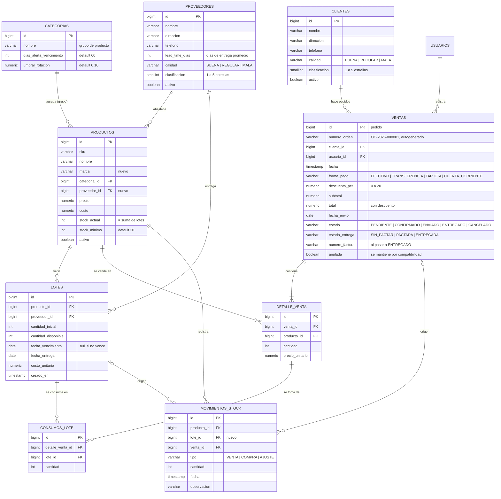

# Plan de mejoras — SmartStock como distribuidor mayorista

> Estado: **aprobado** (31-10-2026, D1 a D7 con la opción recomendada). **Objetivo actualizado el 31-10: todo para el 4-11 (ver §9).** Basado en `develop` @ `d4d588f` (incluye #5 tests de controllers, #6 historial de movimientos y #7 anulación de ventas).

## 1. Nuevo escenario

SmartStock pasa a modelar un **distribuidor mayorista (trade)**: compra mercadería a **proveedores** y la revende a **clientes** que son supermercados chicos (Día Express, Carrefour Express, Chino Almagro, Jumbo Express). El modelo sirve para cualquier PyME que compre y revenda.

Flujo: proveedor → **lote** (con vencimiento) → stock → **pedido** del cliente → confirmación (descuenta stock FEFO) → envío → entrega + **factura**.

## 2. Decisiones tomadas

Se aprobó la opción recomendada en todas. La última columna queda como referencia de lo que se descartó.

| # | Tema | Propuesta | Si se elige lo contrario |
|---|------|-----------|--------------------------|
| D1 | Ventas vs. pedidos | **Ampliar la tabla `ventas` para que sea el pedido** (cabecera) y `detalle_venta` el detalle. La pantalla Ventas pasa a ser **Pedidos**. Las 90 días de ventas históricas quedan como pedidos ENTREGADOS, y analytics sigue entrenando con las mismas tablas. La anulación de Nico (#7) se convierte en **cancelar pedido** y reutiliza su lógica de bloqueos. | Tablas nuevas `pedidos`/`detalle_pedido`: hay que migrar los datos, reescribir las consultas de analytics y la anulación queda sin uso. |
| D2 | Entrega intermedia (4-11) | Prioridad según el **orden de implementación**: Proveedores, Producto y Clientes. | Si era "Lotes" en vez de Clientes, se adelanta el paso 4, que es el más riesgoso (cambia cómo se descuenta stock). |
| D3 | Historial del cliente antes de Pedidos | En el paso 3 se agrega `ventas.cliente_id` y el seed reparte las ventas históricas entre los clientes. Así la pantalla del cliente muestra historial y productos/marcas **ya para el 4-11**. | El historial del cliente recién aparece en el paso 5. |
| D4 | Issue #10 (botón anular) | Se absorbe en la pantalla de Pedidos (tarea 5.4, "Cancelar pedido"). Cerrar #10 como reemplazado. | Si se hace igual ahora, se rehace en el paso 5. |
| D5 | Stock mínimo existente | Default nuevo de 30 y los 8 productos actuales pasan a 30 (hoy tienen 10 a 30). Varios quedan debajo del mínimo, lo que sirve para la demo de alertas. | Conservar los valores actuales y aplicar 30 solo a productos nuevos. |
| D6 | Permisos de pedidos | VENDEDOR crea, confirma, envía y entrega. **Cancelar solo ADMIN** (igual que la anulación actual). No se puede cancelar un pedido ENVIADO o ENTREGADO. | — |
| D7 | Estado de entrega | Se calcula, no se carga: SIN_PACTAR sin fecha de envío, PACTADA con fecha, ENTREGADA al pasar a ENTREGADO. | Campo editable a mano. |
| D8 | Quién implementa | **Cada integrante implementa su parte**: Java → Nicolas-ok, Python → marcelodanieldm, front → Florencia (con ayuda de Claude Code). | — |

## 3. Modelo de datos

Cambios solo con scripts nuevos en `database/init/`; no se editan `01`, `02` ni `03`. Cada script incluye su parte de datos de prueba y es idempotente (`IF NOT EXISTS`) para poder aplicarlo a bases existentes como hizo Nico con el `03`.

| Script | Paso | Contenido |
|--------|------|-----------|
| `04_proveedores.sql` | 1 | Tabla `proveedores`; `productos.proveedor_id`, `productos.marca`. Seed: 4 proveedores con lead time y calificación variados; marca y proveedor en los 8 productos. |
| `05_grupos_stock_minimo.sql` | 2 | `categorias` pasa a ser el **grupo de producto**: `dias_alerta_vencimiento` (default 60) y `umbral_rotacion` (default 0.10). `stock_minimo` default 30. Seed: grupos Lácteos (15 días), Frescos (10), Almacén (60), Bebidas (90), Limpieza (120) y productos nuevos con marcas. |
| `06_clientes.sql` | 3 | Tabla `clientes`; `ventas.cliente_id`. Seed: Día Express, Carrefour Express, Chino Almagro, Jumbo Express y "Consumidor final"; reparto de las ventas históricas. |
| `07_lotes.sql` | 4 | Tablas `lotes` y `consumos_lote`; `movimientos_stock.lote_id`. Migración: un lote inicial por producto con su `stock_actual`. Seed: lotes con vencimientos escalonados (algunos dentro de la ventana de alerta). |
| `08_pedidos.sql` | 5 | Columnas de pedido en `ventas`; secuencias de orden y factura. Migración: ventas históricas → ENTREGADO con factura; `anulada = true` → CANCELADO. `anulada` se mantiene sincronizada hasta que analytics deje de usarla. |
| `09_parametros_reposicion.sql` | 7 | Parámetros `margen_dias_proveedor_bajo` y `clasificacion_proveedor_baja`. |

**Regla invariante desde el paso 4:** `productos.stock_actual = SUM(lotes.cantidad_disponible)` del producto. Cada entrada o salida actualiza ambos dentro de la misma transacción.

## 4. Cómo encaja con lo que hizo Nico

- **Anulación (#7):** el bloqueo de la venta y el orden de bloqueo de productos (`bloquearProductos`) se reutilizan para confirmar y cancelar pedidos.
  - En el paso 4, anular tiene que devolver el stock **a los mismos lotes de los que salió**. Para eso existe `consumos_lote`.
  - En el paso 5, `POST /api/ventas/{id}/anular` pasa a ser `POST /api/pedidos/{id}/cancelar`. La ruta vieja sigue funcionando hasta que el front migre y después se quita.
  - El flag `anulada` se mantiene sincronizado con `estado = CANCELADO` para que analytics no se rompa entre PRs. Analytics pasa a filtrar por estado en la tarea 5.3.
- **Historial (#6):** cada movimiento suma `loteId` (paso 4) y el número de orden del pedido (paso 5). Conviene mergear **#8 (paginación) antes del paso 4**, porque con lotes el historial crece más.
- **403 sin cuerpo:** antes de las pantallas nuevas, el 403 tiene que devolver `{"error": "..."}`. Así el front puede decir "No tenés permiso" en todas las secciones de solo lectura para VENDEDOR (tarea 0.2).
- **#9 (matriz de permisos):** cada tarea de core que agrega rutas suma sus casos a `ControllersTest` (criterio de aceptación en todas).
- **CI con PostgreSQL:** las tareas de lotes y pedidos llevan tests de integración (concurrencia FEFO, rollback) en la suite que armó Nico.

## 5. Endpoints nuevos

### core-service (`/api`)

| Método | Ruta | Rol | Paso |
|--------|------|-----|------|
| GET | `/proveedores` · `/proveedores/{id}` | Admin, Vendedor | 1 |
| POST · PUT · DELETE (baja lógica) | `/proveedores` · `/proveedores/{id}` | Admin | 1 |
| GET | `/proveedores/{id}/productos` (productos y marcas) | Admin, Vendedor | 1 |
| — | `/productos`: se agregan `marca`, `proveedorId`, `proveedor`, `grupo` y `stockMinimo` editable | — | 2 |
| PUT | `/categorias/{id}` (nombre, días de alerta de vencimiento, umbral de rotación) | Admin | 2 |
| GET | `/clientes` · `/clientes/{id}` | Admin, Vendedor | 3 |
| POST · PUT · DELETE (baja lógica) | `/clientes` · `/clientes/{id}` | Admin | 3 |
| GET | `/clientes/{id}/pedidos` · `/clientes/{id}/productos` (calculado desde pedidos) | Admin, Vendedor | 3 |
| — | `POST /ventas`: acepta `clienteId` | — | 3 |
| — | `POST /compras` **(cambia el contrato)**: suma `proveedorId`, `fechaVencimiento`, `fechaEntrega` y `costoUnitario`, y crea un lote | — | 4 |
| GET | `/productos/{id}/lotes` · `/productos`: suma `proximoVencimiento` | Admin, Vendedor | 4 |
| POST | `/pedidos` (crea PENDIENTE) · GET `/pedidos?estado=&clienteId=&desde=&hasta=` · GET `/pedidos/{id}` | Admin, Vendedor | 5 |
| POST | `/pedidos/{id}/confirmar` (descuenta FEFO) · `/enviar` · `/entregar` (genera la factura) | Admin, Vendedor | 5 |
| POST | `/pedidos/{id}/cancelar` (devuelve el stock si estaba confirmado) | Admin | 5 |

### analytics-service (`/api`)

| Ruta | Devuelve | Paso |
|------|----------|------|
| `/vencimientos` | Lotes que vencen dentro de los N días de su grupo, con criticidad y "vender primero" | 4 |
| `/rotacion` · `/rotacion/grupos` | Rotación de 30 días por producto y por grupo, contra el umbral del grupo, con sugerencia | 6 |
| `/predicciones` (amplía) | Suma `lead_time_dias`, `punto_reposicion`, `fecha_reposicion` y `comprar_ahora` | 7 |
| `/alertas/panel` | Alertas unificadas: `tipo`, producto, criticidad, detalle y acción sugerida | 8 |

`/api/alertas` actual no cambia, porque lo usa el dashboard. El panel es un endpoint nuevo.

### Reglas de cálculo

- **Total del pedido:** suma de (cantidad × precio unitario) × (1 − descuento / 100), redondeado a 2 decimales. Si el descuento no está entre 0 y 20, la respuesta es 400.
- **FEFO:** al confirmar, se bloquean los productos en orden de id y, dentro de cada producto, los lotes con disponible > 0 ordenados por vencimiento, con los NULL (sin vencimiento) al final, y por id. Cada parte consumida queda en `consumos_lote`. Si falta stock se hace rollback de todo.
- **Stock mínimo:** no bloquea la venta. Si al confirmar un producto queda debajo del mínimo, la respuesta incluye `advertencias` y el producto aparece en el panel de alertas.
- **Vencimiento:** un lote entra en alerta si vence dentro de los N días de su grupo. Criticidad ALTA si ya venció o faltan ≤ 7 días, MEDIA si faltan ≤ N/2 y BAJA en el resto.
- **Rotación:** unidades vendidas en 30 días / stock promedio de esos 30 días (reconstruido con `stock_historico`). Si es ≥ umbral, el producto está sano. Si es menor, hay alerta de baja rotación con sugerencia escalonada: menor a la mitad del umbral, "no recomprar / promocionar"; si no, "comprar menos". Con stock promedio 0 no se calcula.
- **Punto de reposición:** demanda diaria proyectada × (lead time del proveedor + margen) + stock mínimo.
  - El margen es `margen_dias_proveedor_bajo` (default 3) si la clasificación del proveedor es ≤ 2 estrellas o su calidad es MALA; si no, 0.
  - `comprar_ahora` vale true cuando el stock proyectado de hoy ya está ≤ punto de reposición. `fecha_reposicion` es el primer día en que lo cruza.
  - Sin proveedor se usa el parámetro global `dias_reposicion`.
  - El lote sugerido pasa a usar el lead time real.

## 6. Pantallas

| Pantalla | Cambios | Paso |
|----------|---------|------|
| **Proveedores** (nueva) | Lista con lead time, calidad y estrellas; ABM solo ADMIN; detalle con sus productos y marcas | 1 |
| **Catálogo** | Columnas de marca y proveedor; formulario con proveedor, marca, grupo y stock mínimo (precargado en 30) | 2 |
| **Grupos** (nueva, ADMIN, junto a Parámetros) | Por grupo: días de alerta de vencimiento y umbral de rotación | 2 |
| **Clientes** (nueva) | Lista con calidad y estrellas; ABM solo ADMIN; detalle con historial de pedidos y productos/marcas que compra | 3 |
| **Ventas** | Selector de cliente con su calificación bien visible | 3 |
| **Catálogo** | Ingreso de mercadería con proveedor, vencimiento, fecha de entrega y costo; columna "próximo vencimiento"; detalle de lotes | 4 |
| **Pedidos** (reemplaza Ventas) | Armado del pedido: cliente con estrellas, forma de pago, descuento con tope de 20 y fecha de envío. Lista con filtros por estado y acciones confirmar / enviar / entregar / cancelar. Vista de factura. Incluye #10 | 5 |
| **Monitor predictivo** | Rotación por producto y por grupo | 6 |
| **Monitor predictivo** | Punto de reposición y badge "Comprar ahora" | 7 |
| **Monitor predictivo** | Panel unificado de alertas con filtro por tipo y criticidad | 8 |

## 7. Tareas en orden

Una tarea = un issue = una rama = una PR hacia `develop`. Cuando una tarea toca la base, el script va en la PR del servicio que lo usa primero.

| # | Tarea | Comp. | Responsable | Rama | Depende de |
|---|-------|-------|-------------|------|-----------|
| 0.1 | README y docs con el escenario mayorista | docs | Florencia | `feature/devops-escenario-mayorista` | — |
| 0.2 | 403 con cuerpo JSON `{"error"}` en `SecurityConfig` | core | Nicolas | `fix/core-403-con-cuerpo` | — |
| **1.1** | Proveedores: script `04`, entidad, CRUD, `/proveedores/{id}/productos`, tests | core + db | Nicolas | `feature/core-proveedores` | — |
| **1.2** | Pantalla Proveedores | front | Florencia | `feature/front-proveedores` | 1.1 |
| **2.1** | Producto: marca, proveedor, grupo y stock mínimo; script `05`; PUT de categorías, tests | core + db | Nicolas | `feature/core-producto-grupos` | 1.1 |
| **2.2** | Catálogo ampliado y pantalla Grupos | front | Florencia | `feature/front-catalogo-grupos` | 2.1, 1.2 |
| **3.1** | Clientes: script `06`, CRUD, historial y productos del cliente, `clienteId` en ventas, tests | core + db | Nicolas | `feature/core-clientes` | 2.1 |
| **3.2** | Pantalla Clientes y selector de cliente en Ventas | front | Florencia | `feature/front-clientes` | 3.1 |
| 4.1 | Lotes: script `07`, ingreso de mercadería crea lote, `/productos/{id}/lotes`, `proximoVencimiento` | core + db | Nicolas | `feature/core-lotes` | 3.1, #8 |
| 4.2 | FEFO en ventas y pedidos (enchufa en la confirmación de 5.1) y devolución a lotes al anular o cancelar, con tests de integración | core | Nicolas | `feature/core-fefo` | 4.1, 5.1 |
| 4.3 | Endpoint `/vencimientos` con N por grupo | analytics | Daniel | `feature/analytics-vencimientos` | 4.1 |
| 4.4 | Ingreso de mercadería con lote, columna de vencimiento y detalle de lotes | front | Florencia | `feature/front-lotes` | 4.1 |
| 5.1 | Pedidos: script `08`, cabecera, descuento, número de orden, estados y confirmar | core + db | Nicolas | `feature/core-pedidos` | 3.1 (FEFO se suma en 4.2) |
| 5.2 | Enviar, entregar con factura y cancelar (reemplaza anular) | core | Nicolas | `feature/core-pedidos-entrega` | 5.1 |
| 5.3 | Demanda e ingresos según el estado del pedido y el total con descuento | analytics | Daniel | `feature/analytics-pedidos` | 5.1 |
| 5.4 | Pantalla Pedidos (reemplaza Ventas, incluye #10) | front | Florencia | `feature/front-pedidos` | 5.2 |
| 6.1 | Rotación por producto y por grupo | analytics | Daniel | `feature/analytics-rotacion` | 1.1, 2.1 |
| 6.2 | Rotación en el monitor | front | Florencia | `feature/front-rotacion` | 6.1 |
| 7.1 | Lead time y punto de reposición; script `09` | analytics + db | Daniel | `feature/analytics-lead-time` | 1.1, 2.1 |
| 7.2 | Punto de reposición y "comprar ahora" en el monitor | front | Florencia | `feature/front-reposicion` | 7.1 |
| 8.1 | `/alertas/panel` unificado | analytics | Daniel | `feature/analytics-panel-alertas` | 4.3, 6.1, 7.1 |
| 8.2 | Panel de alertas en el dashboard | front | Florencia | `feature/front-panel-alertas` | 8.1 |

**Para el 4-11: todas** (cambio del 31-10, ver §9). Las negritas marcan las tareas que ya estaban comprometidas antes del cambio.

**Criterios de aceptación comunes a todas:**
- Tests de la lógica nueva (JUnit o pytest); los existentes siguen pasando.
- CI en verde.
- Rutas nuevas agregadas a `ControllersTest`.
- Contrato documentado en `docs/` **en el primer commit de la PR** (`docs(<componente>): …`), para que quien depende arranque con datos de ejemplo sin esperar el merge.
- `docker compose down -v && docker compose up --build` levanta sin errores.
- `docs/PLAN.md` actualizado al cerrar el paso.

## 8. Riesgos

- **Migración del paso 4:** pasar el stock actual a lotes iniciales necesita fechas de vencimiento estimadas. Se documenta como "lote de apertura".
- **Bases existentes:** cada script nuevo obliga a migrar o recrear la base. Se avisa en cada PR y en la minuta.
- **Contratos que cambian:** `POST /compras` (paso 4), `POST /ventas` → `/pedidos` (paso 5) y la anulación → cancelar (paso 5). Las PRs de front van inmediatamente después de las de core.
- **Cuello de botella en core:** casi todo el camino crítico pasa por core-service (una sola persona). Ver §9.

## 9. Objetivo 4-11 y camino crítico

**Objetivo (31-10):** los pasos 1 a 8 completos para el **miércoles 4-11**. La entrega final (12-11) queda para ajustes según la devolución del profe. Todos los issues abiertos están en el milestone [Entrega 4-11](https://github.com/festrada-it/smartstock/milestone/1).

**Regla:** ninguna tarea se frena por fechas. Quien depende de otra tarea:
1. arranca con el contrato publicado y datos de ejemplo;
2. conecta cuando se mergea.

Por eso el contrato va en el primer commit de cada PR.

**Corte del lunes 2-11 a la noche:** si algo no llega, se prioriza la demo de punta a punta: **login → producto → proveedor → cliente → pedido → alertas**. Lotes/FEFO, rotación y vencimientos son lo primero que se posterga.

### Cambios de orden respecto del plan original
- **Pedidos (5.1, 5.2) antes que lotes (4.1, 4.2).** El pedido está en la demo y los lotes no.
  - 5.1 confirma descontando stock con el bloqueo de productos que ya existe.
  - 4.2 después enchufa FEFO en esa confirmación.
  - Los scripts conservan su número: `07` lotes y `08` pedidos. En una base nueva corren en orden; en una existente se aplica el que falte.
- **Rotación (6.1) y lead time (7.1) ya no esperan a 5.3.** Usan las ventas actuales, que excluyen las anuladas, y 5.3 las adapta a los estados de pedido (#28, #30).

### Merges que destraban al resto
| Orden | Qué | Destraba |
|-------|-----|----------|
| 1 | **#35** proveedores (aprobada) | #36, front Proveedores (#39), lead time en analytics (#42) |
| 2 | **#36** producto y grupos (faltan 2 ajustes y rebase) | #37, front Catálogo y Grupos (#17), rotación (#43), stock mínimo en alertas |
| 3 | **#37** clientes (aprobada, rebase después de #36) | front Clientes (#19), pedidos (#24) |
| 4 | **Contrato de pedidos** (`docs/API-PEDIDOS.md`, primer commit de #24) | front Pedidos (#27), analytics de pedidos (#26) |
| 5 | **#42 integrada** (`/api/predicciones` con `comprar_ahora`) | front Reposición (#31), panel de alertas (#44) |
| 6 | **#24 → #25** pedidos | demo completa del flujo de venta |
| 7 | **Contrato de lotes** (primer commit de #20) → #20 → #21 | vencimientos (#22, #41), front Lotes (#23) |

### En paralelo desde hoy
| Quién | Ahora | Con contrato y datos de ejemplo | Al mergear la dependencia |
|-------|-------|--------------------------------|---------------------------|
| **Nicolas** | Mergear #35. Ajustes y rebase de #36. Rebase de #37. Publicar los contratos de pedidos (#24) y lotes (#20) | — | #24 → #25 → #20 → #21. Las chicas (#13 en #38, #8, #9, #40) en los huecos o si espera revisión |
| **Marcelo** | Mergear #41 como avance. Ajustar el contrato de #42 (`margen_dias`, `proveedor`) | Integración de #42 contra el esquema de #35. Rotación (#43) contra el de #36. Panel (#44) | Conectar #42 al mergear #35 (script `09`, `db.py`, `/api/predicciones`). #26 con el contrato de #24. #22 con el de #20 |
| **Florencia** | Catálogo y Grupos (#17, contrato de #36). Clientes (#19, contrato de #37) | Pedidos (#27) con los campos de #24. Panel de alertas (#33, contrato de #44). Reposición (#31, contrato de #42). Rotación (#29). Lotes (#23) | Conectar #39 al mergear #35; después #17, #19, etc. a medida que entran |

**Revisiones:** cada PR necesita 1 aprobación de otra persona. Para no trabar el camino crítico, las PRs de core se revisan en el día.
